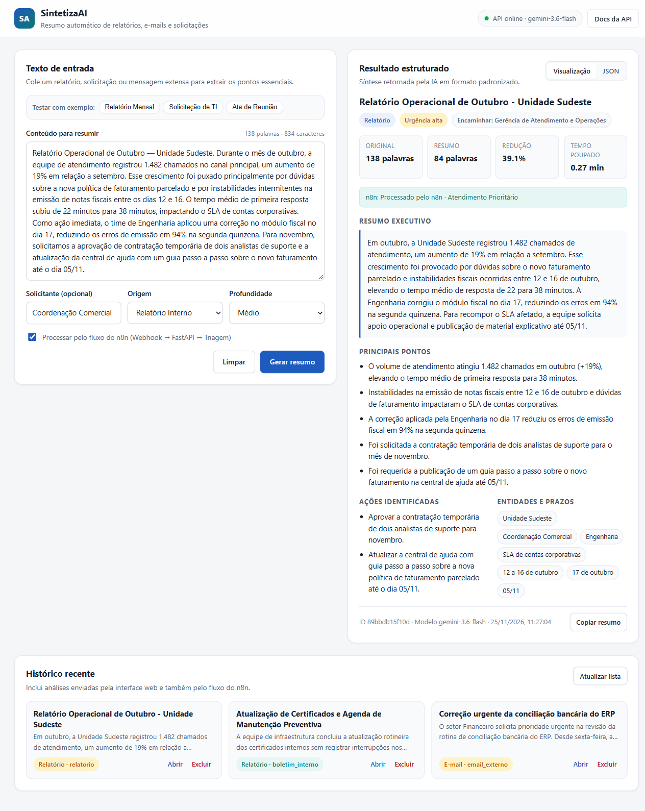
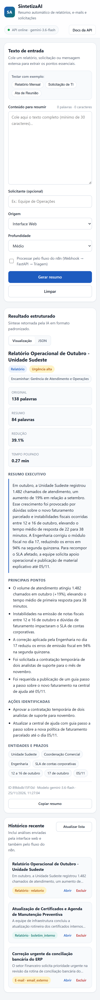
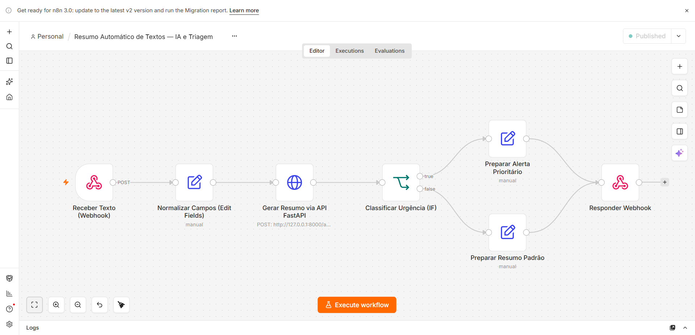
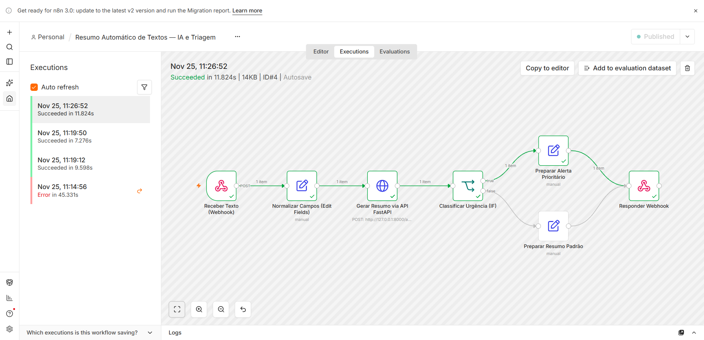
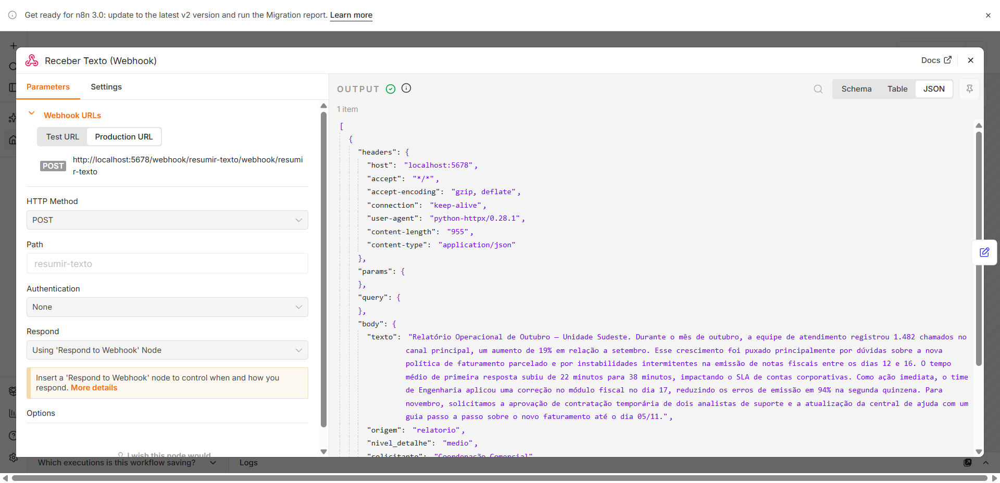
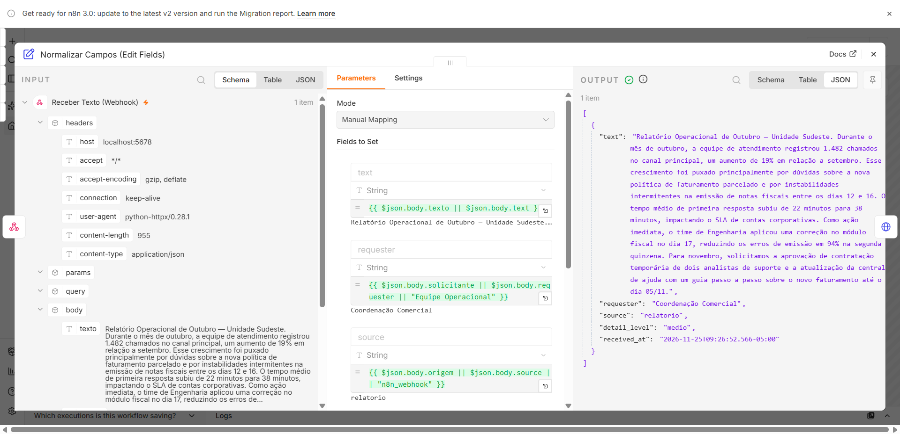
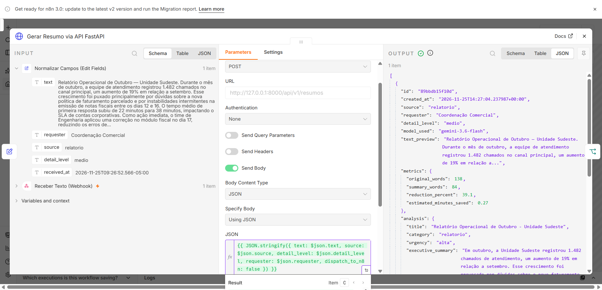
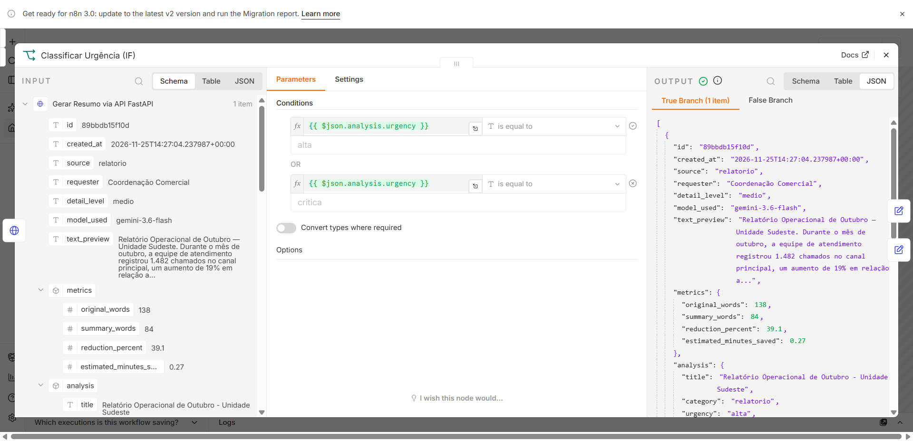
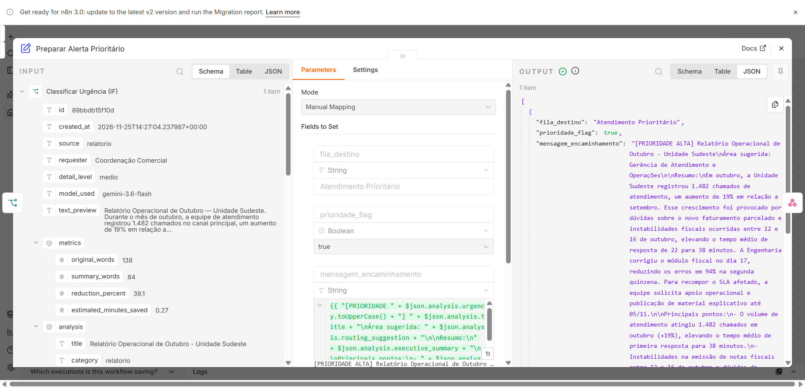
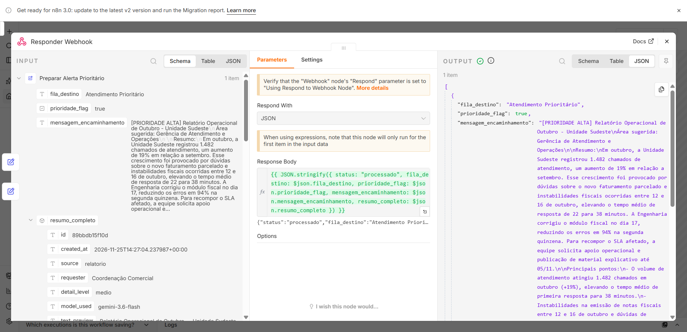

# SintetizaAI — Resumo Automático de Textos

Projeto integrador desenvolvido para o **Desafio Técnico — IA e Automação (KODIE)**, aplicando o cenário **4.2 — Resumo Automático de Textos**. A aplicação combina uma API em **FastAPI**, integração estruturada com o **Google Gemini**, um **front-end responsivo** e um fluxo de triagem automatizada no **n8n**.

---

## 1. Apresentação da Ideia

Quem trabalha com suporte, operações, financeiro ou gestão de produto sabe que o gargalo raramente está na falta de informação — na maioria das vezes ele está no excesso de texto mal estruturado. Relatórios operacionais, atas de reunião e solicitações urgentes chegam em blocos longos por e-mail ou chat, e alguém precisa ler tudo do início ao fim só para descobrir qual é o assunto, o nível de urgência e quem deve agir primeiro.

A ideia deste projeto surgiu justamente dessa rotina: em vez de tratar IA apenas como um chat para responder perguntas soltas, faz muito mais sentido encaixá-la como uma etapa de processamento dentro de um fluxo real. O sistema recebe o texto bruto, extrai um resumo objetivo junto com os pontos principais e ações pendentes em JSON validado e já entrega o resultado pronto para o fluxo de automação decidir o encaminhamento.

---

## 2. Problema Escolhido

**Cenário 4.2 — Resumo Automático de Textos**

> *"Uma equipe recebe diariamente textos extensos, relatórios ou solicitações e precisa dedicar muito tempo à leitura dessas informações. Desenvolva uma solução que utilize IA para gerar resumos automáticos, destacando os principais pontos de cada texto."*

Na prática, resumir um texto em texto livre não resolve todo o problema se o time ainda precisar classificar manualmente se aquilo é urgente ou qual setor precisa atuar. Por isso, além do resumo executivo e da lista de pontos-chave, o sistema também identifica categoria, urgência, entidades/prazos citados, itens de ação e sugestão de área responsável.

---

## 3. Solução Proposta

A solução foi dividida em três camadas desacopladas que conversam via HTTP/JSON:

1. **Back-end em FastAPI (`aplicacao/`)**: expõe os endpoints REST, valida o texto recebido com Pydantic, constrói o prompt adequado à profundidade solicitada (`curto`, `medio` ou `detalhado`), consulta a API do Google Gemini com `response_schema` para garantir JSON estrito e calcula métricas de redução de leitura.
2. **Automação no n8n (`automacao/fluxo_resumo_textos.json`)**: recebe payloads externos via Webhook, normaliza campos opcionais em português ou inglês, chama a API FastAPI para gerar o resumo com IA, avalia a urgência retornada (`alta` ou `critica` versus `baixa` ou `media`) em um node condicional `IF`, formata uma mensagem pronta para encaminhamento e devolve a resposta consolidada ao chamador.
3. **Front-end responsivo (`interface/`)**: interface web limpa em HTML5, CSS3 e JavaScript puro para colar textos manualmente, carregar exemplos prontos, alternar entre visualização formatada e inspeção do JSON bruto, consultar o histórico recente e, quando desejado, disparar o processamento diretamente pelo fluxo do n8n.

### Como a IA participa do processo

A classe `GeminiSummarizerService` utiliza o SDK oficial `google-genai` com saída estruturada (`StructuredAiOutput`). Em vez de pedir ao modelo que responda em Markdown e depois tentar quebrar o texto com expressões regulares, o schema Pydantic é enviado diretamente na configuração da chamada (`response_mime_type="application/json"` e `response_schema=StructuredAiOutput`), acompanhado de regras de sistema definidas em `PromptBuilder` para impedir invenção de fatos e preservar números, datas e prazos.

Durante os testes reais com a API do Google, alguns modelos específicos apresentaram picos temporários de carga (`503 UNAVAILABLE`). Para evitar que uma oscilação pontual derrube o fluxo do n8n, o serviço trabalha com o `gemini-3.6-flash` como modelo principal e uma fila configurável de fallback automático (`gemini-3.5-flash`, `gemini-3.8-flash` e `gemini-3.5-flash-lite`) com timeout controlado por tentativa.

---

## 4. Tecnologias Utilizadas

| Camada | Tecnologia / Biblioteca | Papel no projeto |
| --- | --- | --- |
| Inteligência Artificial | **Google Gemini API** (`google-genai`) | Síntese, extração de pontos-chave, ações e classificação em JSON |
| Back-end | **Python 3.12** + **FastAPI** + **Uvicorn** | API REST, validação de contratos e servidor de arquivos estáticos |
| Validação e Config | **Pydantic v2** + **pydantic-settings** | Schemas estritos de entrada/saída e leitura segura do `.env` |
| Cliente HTTP | **HTTPX** | Comunicação assíncrona entre FastAPI e o Webhook do n8n |
| Automação | **n8n** (`v2.35.7` via Node.js) | Orquestração via Webhook, normalização, chamada HTTP e triagem |
| Front-end | **HTML5, CSS3 e JavaScript ES6+** | Interface responsiva para desktop, tablet e celular |
| Testes | **Pytest** + `TestClient` | Testes automatizados de prompt, métricas, fallback e rotas da API |

### Organização das pastas

As pastas do repositório seguem nomenclatura em português, enquanto as classes em Python, JavaScript e seletores CSS seguem padrão em inglês:

```text
.
├── aplicacao/                  # Código-fonte da API FastAPI
│   ├── modelos/                # Schemas Pydantic (SummaryRequest, StructuredAiOutput, SummaryResponse...)
│   ├── rotas/                  # Controladores HTTP (SummaryController)
│   ├── servicos/               # PromptBuilder, GeminiSummarizerService, AutomationWebhookClient, SummaryHistoryRepository
│   ├── configuracao.py         # AppSettings carregado do .env
│   └── principal.py            # ApplicationFactory e montagem do front-end
├── automacao/                  # Fluxo exportado do n8n
│   └── fluxo_resumo_textos.json
├── dados/                      # Armazenamento local do histórico (JSON ignorado pelo Git)
├── documentacao/
│   └── imagens/                # Prints do front-end e do fluxo no n8n
├── interface/                  # Front-end responsivo
│   ├── estilos/principal.css
│   ├── scripts/aplicacao.js    # SummaryApiClient, SummaryResultView, HistoryListView, SummarizerApp
│   ├── scripts/exemplos.js     # SampleTextCatalog
│   └── index.html
├── testes/
│   └── testar_resumos.py       # TestPromptAndMetrics, TestSummaryApiEndpoints
├── .env.example                # Modelo das variáveis de ambiente (sem credenciais)
├── .gitignore
├── README.md
└── requirements.txt
```

---

## 5. Funcionamento do Sistema

### Fluxo completo da informação

```text
[Cliente / Front-end]
        │
        ├──(Modo direto)──────────────────────────┐
        │                                         ▼
        └──(Modo n8n)──► [Webhook n8n] ─► [Edit Fields] ─► [HTTP Request: POST /api/v1/resumos]
                                                                    │
                                                                    ▼
                                                        [FastAPI + PromptBuilder + Gemini]
                                                                    │
                                                                    ▼
[Resposta JSON] ◄── [Respond to Webhook] ◄── [Alerta Prioritário / Resumo Padrão] ◄── [IF Urgência]
```

### Principais endpoints da API

- `GET /api/v1/health`: informa se a chave da API Gemini e a URL do webhook do n8n estão configuradas.
- `POST /api/v1/resumos`: recebe `{ text, source, detail_level, requester, dispatch_to_n8n }`. Quando `dispatch_to_n8n` é `false`, chama o Gemini diretamente, calcula métricas e salva no histórico local (`dados/historico_resumos.json`). Quando `true`, delega a execução ao webhook do n8n e registra o retorno triado no histórico.
- `GET /api/v1/resumos`: retorna os resumos armazenados recentemente.
- `GET /api/v1/resumos/{summary_id}` e `DELETE /api/v1/resumos/{summary_id}`: consulta individual e remoção do histórico.

### Front-end responsivo

A interface foi validada em desktop (`1280x800`), tablet (`768x1024`) e celular (`375x812`), adaptando o grid de duas colunas para pilha vertical, reorganizando os cards de métricas e mantendo o bloco de JSON com rolagem interna (`overflow-x: auto`) sem gerar estouro horizontal na página.

| Visão Desktop (`1280x800`) | Visão Mobile (`375x812`) |
| --- | --- |
|  |  |

---

## Documentação Visual do Fluxo de Automação (n8n)

O fluxo **"Resumo Automático de Textos — IA e Triagem"** (disponível para importação em [automacao/fluxo_resumo_textos.json](automacao/fluxo_resumo_textos.json)) foi implementado e executado no n8n local conectado à API FastAPI.

### 1. Estrutura completa do fluxo

Visão geral no editor do n8n com todos os 7 nodes conectados desde a entrada via Webhook até o retorno estruturado:



### 2. Execução concluída com sucesso

Registro da execução `ID#4` disparada pelo webhook (`Succeeded in 11.824s`), mostrando o caminho percorrido com `1 item` processado pelo ramo prioritário após a classificação da IA indicar urgência alta:



### 3. Configuração individual e dados de cada node

#### Node 1 — `Receber Texto (Webhook)`
Recebe requisições `POST` no path `resumir-texto` com o modo de resposta configurado para `Using 'Respond to Webhook' Node`. Na coluna `OUTPUT`, é possível conferir o JSON recebido em `body` (`texto`, `origem`, `nivel_detalhe` e `solicitante`):



#### Node 2 — `Normalizar Campos (Edit Fields)`
Padroniza os nomes dos campos para o contrato esperado pela API (`text`, `requester`, `source`, `detail_level`), aceitando tanto chaves em português quanto em inglês e registrando o timestamp `received_at`:



#### Node 3 — `Gerar Resumo via API FastAPI` (`HTTP Request`)
Envia um `POST` em JSON para `http://127.0.0.1:8000/api/v1/resumos` passando os campos normalizados com `dispatch_to_n8n: false` (para evitar recursão). No `OUTPUT`, a API devolve as métricas calculadas e o objeto `analysis` gerado pelo modelo `gemini-3.6-flash`:



#### Node 4 — `Classificar Urgência (IF)`
Avalia a expressão `{{ $json.analysis.urgency }}` comparando se o resultado é igual a `alta` **OU** `critica`. Quando verdadeiro, encaminha o item pelo `True Branch` para tratamento prioritário; caso contrário (`baixa` ou `media`), segue pelo `False Branch`:



#### Node 5 — `Preparar Alerta Prioritário` (`Edit Fields` — ramo `true`)
Define `fila_destino` como `"Atendimento Prioritário"`, `prioridade_flag: true`, monta o texto consolidado `mensagem_encaminhamento` com título, área sugerida, resumo executivo e pontos principais, e preserva `resumo_completo` para o retorno da API:



*(No ramo `false`, o node `Preparar Resumo Padrão` segue a mesma estrutura marcando `fila_destino` como `"Fila Regular"` e `prioridade_flag: false`.)*

#### Node 6 — `Responder Webhook` (`Respond to Webhook`)
Consolida o JSON final (`status`, `fila_destino`, `prioridade_flag`, `mensagem_encaminhamento` e `resumo_completo`) e devolve a resposta HTTP ao sistema chamador:



---

## 6. Como Executar

### Pré-requisitos

- **Python 3.12+**
- **Node.js 20+** (para executar o n8n localmente via `npx`, caso não utilize n8n Cloud)
- Uma chave de API do **Google Gemini** (gerada no Google AI Studio)

### Passo 1 — Clonar e preparar o ambiente virtual Python

```powershell
git clone <url-do-seu-repositorio>
cd 3

python -m venv .venv
.\.venv\Scripts\Activate.ps1
pip install -r requirements.txt
```

### Passo 2 — Configurar variáveis de ambiente

Copie o arquivo de exemplo e preencha a sua chave `GEMINI_API_KEY`:

```powershell
Copy-Item .env.example .env
```

Conteúdo esperado no `.env`:

```env
GEMINI_API_KEY=sua_chave_api_aqui
GEMINI_MODEL=gemini-3.6-flash
GEMINI_FALLBACK_MODELS=gemini-3.5-flash,gemini-3.8-flash,gemini-3.5-flash-lite
APP_HOST=127.0.0.1
APP_PORT=8000
APP_ENV=development
AUTOMATION_WEBHOOK_URL=http://localhost:5678/webhook/resumir-texto
```

### Passo 3 — Rodar os testes automatizados

```powershell
.\.venv\Scripts\pytest.exe -v
```

### Passo 4 — Subir a API FastAPI e o front-end

```powershell
.\.venv\Scripts\uvicorn.exe aplicacao.principal:app --host 127.0.0.1 --port 8000
```

Depois, acesse:
- **Aplicação web:** `http://127.0.0.1:8000`
- **Documentação interativa (Swagger):** `http://127.0.0.1:8000/docs`

### Passo 5 — Subir e importar o fluxo no n8n local

Em outro terminal (de preferência com `N8N_SECURE_COOKIE=false` para uso local em HTTP):

```powershell
$env:N8N_SECURE_COOKIE="false"
npx --yes n8n start
```

1. Acesse `http://localhost:5678` e crie ou entre na sua conta local.
2. Crie um workflow em branco, clique no menu (`...`) e selecione **Import from File**, escolhendo `automacao/fluxo_resumo_textos.json`.
3. Publique/ative o workflow para habilitar o endpoint `POST http://localhost:5678/webhook/resumir-texto`.
4. Você pode testar diretamente pela interface web marcando a opção **"Processar pelo fluxo do n8n (Webhook → FastAPI → Triagem)"** ou enviando um `POST` direto para o webhook:

```powershell
Invoke-RestMethod -Uri "http://localhost:5678/webhook/resumir-texto" `
  -Method Post `
  -ContentType "application/json; charset=utf-8" `
  -Body '{"texto": "Precisamos revisar com urgência a fila de notas fiscais após erro no lote de hoje às 10h. O fechamento vence às 17h e depende do apoio de Engenharia.", "solicitante": "Financeiro", "origem": "email", "nivel_detalhe": "medio"}'
```
